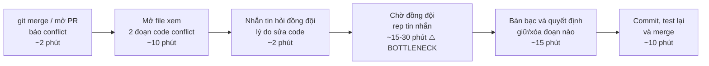
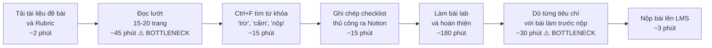
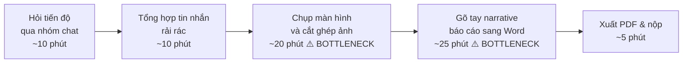

# Báo cáo cá nhân — 2A202603777_DoLyHoangNam

> Đổi tên file theo quy tắc `MSSV_HoTen.md`, ví dụ `20241234_NguyenVanAn.md` (MSSV trước, dấu `_`, họ tên viết liền không dấu). Sửa cả dòng tiêu đề phía trên cho khớp.
> Template chi tiết và prompt mẫu cho từng mục: [docs/01-worksheet.md](../../docs/01-worksheet.md).
> Mỗi thành viên một file trong `report/individual/` trên repo nhóm: copy template này thành file mới, điền, rồi commit bằng tài khoản GitHub của bạn. Không viết hộ người khác.

## 1. Thông tin học viên

- Họ tên: Đỗ Lý Hoàng Nam
- MSSV: 2A202603777
- Email trường (không bắt buộc, repo có thể để public):
- Tên nhóm: B3
- Link repo nhóm: https://github.com/tuancdk/K5-L3B-DAY02-B3-DiscoveryProblemFraming

---

## 2. Scan problem (CP1)

Lăng kính: **Lặp lại** · **Tốn thời gian** · **Cần đọc, tổng hợp nhiều thông tin** · **Pain từ người khác**.

| # | Lăng kính | Job Story: Khi… tôi muốn… để… | Ai chịu ảnh hưởng? | Dấu hiệu thật (thời gian, tần suất, số người, bằng chứng) |
|---:|---|---|---|---|
| 1 | Tốn thời gian | Khi bước vào giai đoạn ôn thi các môn lập trình, tôi muốn nhanh chóng định vị chính xác slide và code mẫu liên quan đến chủ đề cần học, để không phải lục tìm hàng trăm file tải về rải rác. | Sinh viên CNTT (bản thân và bạn cùng lớp) | Thư mục Downloads có hơn 150 file slide/code chưa phân loại; mất 30–45 phút mỗi lần lục tìm lại tài liệu cũ trong 3 nhóm chat Zalo/Discord; lặp lại 1–2 lần/tuần. |
| 2 | Lặp lại | Khi nộp bài tập hoặc điểm danh qua hệ thống lớp học, tôi muốn biết chắc chắn trạng thái bài nộp đã được hệ thống ghi nhận hợp lệ, để không phải F5 và kiểm tra thủ công nhiều lần vì sợ lỗi hệ thống. | Toàn bộ sinh viên lớp L3B (khoảng 30–40 người) | Diễn ra hàng ngày sau mỗi buổi lab; tốn 5–10 phút mỗi lần vào kiểm tra lại; trung bình mỗi buổi có 3–5 tin nhắn hỏi nhóm trưởng/giáo vụ xác nhận đã nhận bài chưa. |
| 3 | Cần đọc, tổng hợp nhiều thông tin | Khi bắt đầu làm các bài lab dài có quy chế phức tạp, tôi muốn nắm bắt ngay các tiêu chí chấm điểm cốt lõi và các ranh giới cấm, để không làm lệch yêu cầu hoặc bị trừ điểm oan. | Thành viên làm bài lab nhóm (4 người/nhóm) | Đề bài lab dài 15–20 trang; mất 45–60 phút đọc lướt nhưng vẫn dễ sót; bài lab trước nhóm từng bị trừ 2 điểm do đọc sót một mục nhỏ trong rubric. |
| 4 | Pain từ người khác | Khi phân công công việc đồ án cho các thành viên trong nhóm, tôi muốn biết rõ trạng thái thực tế của từng đầu việc mà không phải nhắn tin hỏi dồn dập, để tiến độ chung không bị trễ mà không gây áp lực cho các bạn. | Nhóm trưởng và 3 thành viên trong nhóm | Diễn ra 2–3 lần/tuần; nhóm trưởng phải tag tên nhắc nhở 5–6 lần trong nhóm chat; từng có bài tập nộp sát deadline chỉ trước 10 phút vì một thành viên quên task. |
| 5 | Tốn thời gian | Khi các thành viên trong nhóm merge code bị xung đột (conflict), tôi muốn xác định ngay đoạn code nào bị ghi đè và lý do thay đổi, để giải quyết xung đột chuẩn xác mà không làm hỏng tính năng của người khác. | Lập trình viên trong team đồ án (3–4 người) | Xảy ra 1–2 lần mỗi tuần khi tích hợp code; mỗi lần resolve conflict mất từ 30–60 phút; tuần trước từng bị ghi đè mất 1 hàm khiến cả nhóm mất thêm 1 tiếng để debug lại. |
| 6 | Lặp lại | Khi trường có thông báo đổi phòng học hoặc lịch học bù đột xuất, tôi muốn cập nhật tức thì sự thay đổi vào lịch sinh hoạt của mình, để không bị đến nhầm phòng hay lỡ buổi học mà không phải đăng nhập cổng thông tin 2–3 lần mỗi ngày. | Sinh viên toàn trường (hàng nghìn sinh viên) | Kiểm tra cổng thông tin 2 lần/ngày; tuần trước từng có 3 sinh viên trong lớp đến nhầm phòng học cũ do lịch đổi lúc 22h đêm hôm trước mà không kịp đọc thông báo. |
| 7 | Cần đọc, tổng hợp nhiều thông tin | Khi tích hợp một thư viện hoặc SDK mới viết bằng tiếng Anh, tôi muốn nắm ngay các điều kiện ràng buộc cấu hình và tham số quan trọng, để chạy thử thành công mà không mất hàng giờ tra cứu tài liệu kỹ thuật dài dòng. | Lập trình viên làm đồ án | Tài liệu kỹ thuật dài 30–50 trang; mất trung bình 2–3 tiếng chỉ để đọc và lọc được đoạn config mẫu chạy được; hay gặp lỗi phiên bản không tương thích. |
| 8 | Pain từ người khác | Khi tích hợp các phần code do từng thành viên trong nhóm viết vào nhánh chính, tôi muốn mã nguồn tuân thủ một chuẩn định dạng chung ngay từ đầu, để không phải mất công căn chỉnh thụt dòng và đặt lại tên biến thủ công trước khi build. | Lập trình viên phụ trách merge code trong nhóm | Diễn ra cuối mỗi tuần làm đồ án; mất 1–2 tiếng để reformat code thủ công của 3 bạn khác; từng xảy ra tranh cãi trong nhóm về việc code người này viết người kia khó đọc. |
| 9 | Tốn thời gian | Khi đến hạn nộp báo cáo tiến độ đồ án hàng tuần cho giảng viên, tôi muốn tổng hợp nhanh danh sách công việc đã hoàn thành kèm ảnh chụp minh chứng, để hoàn tất báo cáo đúng hạn mà không phải tốn cả buổi tối cắt ghép ảnh và viết changelog thủ công. | Nhóm trưởng hoặc người phụ trách làm báo cáo | Tốn 45–60 phút cho mỗi buổi báo cáo hàng tuần; lặp lại đều đặn suốt 15 tuần học; nhiều tuần phải làm vội lúc 23h đêm cho kịp deadline nộp slide/doc. |
| 10 | Pain từ người khác | Khi đi ăn uống hoặc mua đồ dùng làm đồ án chung với nhóm, tôi muốn tính toán rõ ràng ai nợ ai bao nhiêu tiền sau khi cấn trừ các khoản chi trả trước, để thanh toán sòng phẳng mà không phải ngồi tính tay và đối chiếu từng biên lai chuyển khoản. | Nhóm sinh viên đi ăn/làm bài tập chung (4–6 người) | Tốn 20–30 phút sau mỗi buổi đi chung để cộng hóa đơn; nhóm chat thường xuyên có 4–5 tin nhắn hỏi lại "tớ chuyển thiếu hay thừa bao nhiêu", có lần quên đòi dẫn đến người ứng tiền trước bị thiệt 100k–200k. |

**Nếu có dùng AI để gợi ý thêm:** ý nào AI gợi ý mà bạn giữ lại, ý nào bỏ và vì sao.

- **Ý giữ lại:** Ý #10 về chia tiền chi tiêu nhóm khi đi ăn uống / làm đồ án chung (Pain từ người khác). Tôi giữ lại và tự viết lại theo trải nghiệm thật vì đây là vấn đề rất thực tế khi làm việc nhóm, có quy trình cụ thể (thu bill, tính tiền, chia theo món/đầu người, cấn trừ công nợ), và bước nghẽn tính toán bằng tay rất rõ ràng.
- **Ý bỏ:** Ý về việc lọc các câu trả lời sửa lỗi trên StackOverflow theo phiên bản công nghệ. Tôi quyết định bỏ vì bài toán này phụ thuộc quá nhiều vào ngữ cảnh dự án (project AST, dependencies versions), mang tính kỹ thuật quá sâu và khó khả thi để xây dựng quy trình kiểm chứng trong phạm vi một buổi lab.

---

## 3. Top 3 Problem Cards + quy trình nháp (CP2)

### Bảng chọn top 3

| Rank | Problem | Vì sao chọn | Điều còn chưa chắc |
|---:|---|---|---|
| 1 | #5 — Giải thích ngữ cảnh nghiệp vụ và hỗ trợ resolve Git Merge Conflict (Semantic Code Review) | Bài toán kỹ thuật thực tế sâu sắc của mọi sinh viên CNTT và dev khi làm việc nhóm; có bottleneck cụ thể (30–45 phút chờ đợi và giải mã code người khác); các công cụ hiện có (VS Code, GitLens) chỉ so sánh chữ chứ không hiểu ngữ cảnh; đo lường được bằng metric rõ ràng. | Khả năng phân tích AST và commit context để phát hiện xung đột logic phức tạp có thể vượt quá khả năng xử lý của các rule đơn giản, cần mô hình workflow AI phối hợp với con người (HITL). |
| 2 | #3 — Trích xuất checklist tiêu chí & kiểm tra bài nộp theo Rubric tài liệu Lab dài | Nỗi đau 100% sinh viên gặp phải hàng tuần; quy trình đọc và rà soát thủ công có bottleneck tốn thời gian (45–60 phút); rủi ro mất điểm oan rất rõ ràng; rất dễ phỏng vấn kiểm chứng The Mom Test ngay tại lớp. | Liệu sinh viên có chủ động dùng tool chuyên biệt hay vẫn giữ thói quen ném cả file PDF vào ChatGPT để tóm tắt chung chung. |
| 3 | #9 — Tổng hợp báo cáo tiến độ đồ án hàng tuần từ Git log và kết quả chạy | Tần suất lặp lại liên tục (15 tuần/kỳ); tốn nhiều thời gian cắt ghép ảnh và viết changelog thủ công (45–60 phút/tuần); quy trình rõ ràng từ thu thập dữ liệu đến xuất bản báo cáo. | Nhiều nhóm sinh viên đối phó bằng cách copy git log ném vào chatbot viết qua loa, chưa chắc họ đã sẵn sàng thay đổi quy trình nếu giảng viên không yêu cầu khắt khe. |

### Problem Card #1

| Trường | Nội dung |
|---|---|
| Job Story | Khi các thành viên trong nhóm merge code bị xung đột (conflict) trên nhánh chính, tôi muốn hiểu ngay tại sao đoạn code đó được viết và tác động của từng lựa chọn giữ/xóa, để resolve conflict đúng mà không làm hỏng tính năng của người khác hoặc phải chờ hỏi lại đồng đội. |
| Actor | Lập trình viên trong nhóm đồ án (3–4 người) phụ trách tích hợp code cuối sprint hoặc khi tạo Pull Request |
| Thời điểm / bối cảnh | Cuối mỗi sprint hoặc trước ngày demo sản phẩm, khi nhiều thành viên cùng tạo Pull Request / Change Request (CR) vào nhánh chính. |
| Quy trình hiện tại (3–7 bước) | 1. Chạy `git merge` hoặc mở Pull Request bị conflict → 2. Mở file có conflict markers (`<<<<<<< HEAD`) → 3. Đọc cả 2 đoạn code xung đột → 4. Nhắn tin hỏi đồng đội lý do sửa đoạn code đó → 5. Chờ đồng đội phản hồi (15–30 phút) → 6. Tự quyết định hoặc ngồi call chung để sửa code rồi commit |
| Bottleneck (bước nào, mất bao nhiêu phút) | **Bước 4 & 5:** Chờ đồng đội phản hồi để hiểu ngữ cảnh nghiệp vụ của đoạn code (mất 15–30 phút). Nếu tự quyết mà không hỏi thì có nguy cơ xóa nhầm tính năng hoặc gây regression bug. |
| Impact (nếu không giải thì sao) | Tốn 30–60 phút cho mỗi ca conflict; tuần trước từng bị ghi đè mất 1 hàm authentication khiến nhóm mất thêm 1 tiếng để debug lại trước giờ demo; làm chậm tiến độ release của cả nhóm. |
| Success metric (baseline → target) | Baseline: 30–45 phút/lần xử lý conflict; tỷ lệ lỗi logic/regression bug sau merge là ~15%. $\rightarrow$ Target: ≤ 8 phút/lần; tỷ lệ lỗi logic sau merge giảm về < 1%. Cách đo: Ghi log thời gian resolve conflict và đếm số bug phát sinh sau merge qua 3 sprint liên tiếp. |
| Phương án không dùng AI | Bắt buộc họp call Discord chia sẻ màn hình cùng xem code mỗi khi merge; áp dụng quy ước viết commit message theo chuẩn Conventional Commits (`feat:`, `fix:`) kèm PR description chi tiết. |
| Giả thuyết về AI | AI đọc commit history, PR description và git diff của cả 2 nhánh $\rightarrow$ tóm tắt bằng ngôn ngữ tự nhiên mục đích thay đổi của từng bên $\rightarrow$ phát hiện lỗi xung đột ngữ nghĩa (Breaking change/API mismatch) $\rightarrow$ lập Action Plan 3 bước hướng dẫn dev resolve an toàn. |
| Cảm nhận nhanh | **Workflow** (AI phân tích và đưa ra giải thích ngữ cảnh + gợi ý plan, con người đưa ra quyết định merge cuối cùng - Human-in-the-loop) |

Quy trình nháp hiện tại:

### Problem Card #2

| Trường | Nội dung |
|---|---|
| Job Story | Khi bắt đầu làm các bài lab hoặc đồ án có quy chế chấm điểm phức tạp dài nhiều trang, tôi muốn nắm bắt ngay toàn bộ tiêu chí chấm điểm cốt lõi và các ranh giới bị trừ điểm, để không làm lệch yêu cầu hoặc bị trừ điểm oan vì sót yêu cầu ẩn trong tài liệu. |
| Actor | Sinh viên làm bài lab / đồ án nhóm (người đọc đề và rà soát tiêu chí nộp bài cho nhóm 3–4 người) |
| Thời điểm / bối cảnh | Đầu buổi lab (khi nhận đề) và trước giờ deadline nộp bài (áp lực thời gian cao, tài liệu đề bài và rubric dài 15–20 trang). |
| Quy trình hiện tại (3–7 bước) | 1. Tải toàn bộ tài liệu đề bài, rubric, rules (PDF/Markdown) → 2. Đọc lướt toàn bộ tài liệu từ đầu đến cuối → 3. Dùng Ctrl+F tìm các từ khóa ("điểm", "trừ", "cấm", "nộp") → 4. Ghi chú thủ công các checklist cần nộp ra giấy/Notion → 5. Trước giờ nộp, mở file bài làm đối chiếu thủ công từng dòng với rubric |
| Bottleneck (bước nào, mất bao nhiêu phút) | **Bước 2 & Bước 5:** Đọc rà soát 15–20 trang tài liệu (~45 phút) và đối chiếu thủ công bài làm với rubric trước khi nộp (~30 phút). Tổng tốn ~75/120 phút chỉ để đọc và rà soát, nhưng vẫn thường sót 1–2 tiêu chí trừ điểm phụ ghi ở cuối bảng. |
| Impact (nếu không giải thì sao) | Từng bị trừ 2 điểm do đặt sai tên file báo cáo; bị mất 5 điểm do không xóa file template mẫu; điểm số bị trừ oan ước tính 5–10 điểm/kỳ học. |
| Success metric (baseline → target) | Baseline: 2 lỗi sót tiêu chí/bài lab; mất 75 phút đọc và rà soát thủ công. $\rightarrow$ Target: 0 lỗi sót tiêu chí; giảm thời gian trích xuất và rà soát xuống ≤ 10 phút. Cách đo: Đếm số checklist item bị bỏ sót và số điểm bị trừ do sai quy chế qua 3 bài lab liên tiếp. |
| Phương án không dùng AI | In toàn bộ rubric ra giấy, dùng bút dạ quang highlight các tiêu chí có chữ "CẤM/TRỪ ĐIỂM", phân công 2 thành viên trong nhóm đọc chéo (cross-check) độc lập trước khi nộp. |
| Giả thuyết về AI | AI đọc cấu trúc file Markdown/PDF của đề bài $\rightarrow$ bóc tách bảng điểm, điều kiện tiên quyết, ranh giới cấm $\rightarrow$ sinh ra bảng Checklist tương tác có thể tích chọn $\rightarrow$ quét nhanh file bài làm của sinh viên để cảnh báo trước các mục còn thiếu. |
| Cảm nhận nhanh | **Workflow** (AI trích xuất tiêu chí và audit sơ bộ bài nộp, con người kiểm tra và xác nhận từng mục trước khi bấm submit) |

Quy trình nháp hiện tại:

### Problem Card #3

| Trường | Nội dung |
|---|---|
| Job Story | Khi đến hạn nộp báo cáo tiến độ đồ án hàng tuần cho giảng viên, tôi muốn tổng hợp nhanh danh sách công việc đã hoàn thành kèm minh chứng kết quả, để hoàn tất báo cáo đúng hạn mà không phải tốn cả buổi tối cắt ghép ảnh và viết changelog thủ công. |
| Actor | Nhóm trưởng hoặc thành viên phụ trách viết báo cáo tiến độ đồ án (nhóm 3–4 người) |
| Thời điểm / bối cảnh | Tối Chủ nhật hàng tuần trong suốt 15 tuần học kỳ, trước buổi họp báo cáo tiến độ với giảng viên hướng dẫn. |
| Quy trình hiện tại (3–7 bước) | 1. Nhắn tin hỏi các thành viên tuần này làm được gì → 2. Gom tin nhắn rải rác từ nhóm chat → 3. Chạy `git log` kiểm tra commit → 4. Chụp màn hình kết quả chạy phần mềm và cắt ghép ảnh minh chứng → 5. Soạn thảo văn bản báo cáo theo mẫu Word/Docs |
| Bottleneck (bước nào, mất bao nhiêu phút) | **Bước 4 & 5:** Chụp màn hình, cắt ghép ảnh minh chứng (~20 phút) và gõ lại changelog từ commit kỹ thuật sang văn phong báo cáo gửi giảng viên (~25 phút). Tổng tốn ~45/60 phút quy trình. |
| Impact (nếu không giải thì sao) | Tốn 45–60 phút mỗi tuần × 15 tuần = ~12 giờ mỗi kỳ. Thường phải làm vội lúc nửa đêm khiến nội dung sơ sài, dễ bị giảng viên nhắc nhở và đánh giá thấp tính chuyên nghiệp. |
| Success metric (baseline → target) | Baseline: 45–60 phút/báo cáo. $\rightarrow$ Target: ≤ 15 phút/báo cáo. Chất lượng báo cáo đủ ảnh minh chứng và đúng hạn 100%. Cách đo: Bấm giờ từ lúc bắt đầu làm đến khi hoàn thiện file báo cáo sẵn sàng gửi qua 3 tuần liên tiếp. |
| Phương án không dùng AI | Tạo sẵn template Google Docs chia sẵn bảng tên từng thành viên, đặt hạn chót Chủ nhật ai không tự điền sẽ bị trừ điểm đánh giá nội bộ nhóm. |
| Giả thuyết về AI | AI đọc commit history từ Git và nhận ảnh chụp màn hình được gán tag $\rightarrow$ tự động sinh bản nháp báo cáo theo văn phong chuẩn mực gửi giảng viên. |
| Cảm nhận nhanh | **Workflow** (AI tự động trích xuất commit và dàn trang văn bản, con người rà soát lần cuối trước khi nộp) |

Quy trình nháp hiện tại:

### Card muốn pitch nhất

- Card số: **Card #1** (Giải thích ngữ cảnh nghiệp vụ và hỗ trợ resolve Git Merge Conflict)
- Vì sao: Đây là bài toán có tính thuyết phục kỹ thuật cao nhất đối với lập trình viên; có thể đo lường bằng các metric rõ rệt (thời gian resolve, tỷ lệ regression bug, blocked time); có khoảng trống thị trường rõ ràng khi so sánh với các ứng dụng hiện có như GitLens hay VS Code (chỉ so sánh text chứ không hiểu ngữ cảnh logic); và có kịch bản xử lý lỗi cùng Action Plan cụ thể cho từng Change Request (CR).
- Câu hỏi muốn nhóm phản biện: *"Nếu hai nhánh có sự thay đổi logic quá sâu và đan xen nhiều tầng kiến trúc (như đổi cấu trúc cơ sở dữ liệu), liệu AI có đủ ngữ cảnh để đưa ra action plan an toàn không, hay bắt buộc phải có bước con người call trực tiếp để quyết định?"*

### AI đã phản biện card thế nào

| Điểm yếu AI chỉ ra | Đồng ý? | Đã sửa gì |
|---|---|---|
| AI chỉ ra rằng: *"Nếu định nghĩa problem là 'thiếu tool tự động merge git', bài toán sẽ dính bẫy solution trá hình và trùng lặp với các tính năng 3-way merge của VS Code hay KDiff3."* | **Đồng ý 100%** | Tôi đã viết lại Problem theo góc độ giao tiếp và quy trình: Nỗi đau cốt lõi là **sự mất mát ngữ cảnh nghiệp vụ (Context Mismatch)** giữa 2 dev khi làm việc độc lập, khiến người merge không hiểu ý đồ của người viết code dẫn đến tốn thời gian chờ đợi và gây lỗi logic. |
| AI chỉ ra rằng: *"Metric 'giảm thời gian merge' chưa đủ sức thuyết phục Tech Lead hoặc Dev chấp nhận dùng tool nếu rủi ro merge sai vẫn còn."* | **Đồng ý** | Tôi đã bổ sung thêm metric sống còn về chất lượng: **Tỷ lệ lỗi logic / Regression Bug phát sinh sau merge (từ baseline 15% giảm về < 1%)** và **Thời gian chờ đợi đồng đội (Blocked Time từ 30 phút về 0 phút)**. |
| AI chỉ ra rằng: *"Quy trình hiện tại chưa làm rõ bước nào thực sự là nút thắt tốn thời gian nhất."* | **Đồng ý** | Tôi đã bóc tách rõ trong quy trình và sơ đồ Mermaid: nút thắt không phải là mở file diff (10 phút), mà là **bước chờ đợi đồng đội trả lời tin nhắn để giải thích ngữ cảnh (15–30 phút)**. |

---

## 4. Tôi đã tham gia phần nào (CP3 → CP7)

| Hoạt động | Tôi đã làm gì? | Kết quả / ảnh hưởng tới bài nhóm |
|---|---|---|
| **Pitch Problem Card** | Trình bày bài toán **Git Merge Conflict & Semantic Code Review**. Phân tích rõ rủi ro thực tế: Git hiện tại chỉ so sánh text thô, hoàn toàn không cảnh báo xung đột logic ngầm giữa các file, khiến việc merge code sát giờ demo dễ làm sập nhánh main. | Nhóm nhận thấy rõ tính cấp thiết và rủi ro sập hệ thống; thống nhất đưa bài toán vào vị trí ưu tiên số 1 của nhóm. |
| **Phản biện bài của bạn khác** | Đặt câu hỏi phản biện cho Lê Anh Tuấn (Candidate #1): *"Đã có giải pháp nào tương tự chưa? Sản phẩm này có gì tốt hơn so với các sản phẩm đó?"* | Giúp các thành viên nhìn nhận lại rào cản cạnh tranh lớn của các đề tài khác (như bài đối chiếu bài lab dễ bị thay thế bởi template hoặc chatbot có sẵn); định hướng nhóm hội tụ về đề tài có khoảng trống thị trường thực sự. |
| **Nhận phản biện** | Nhận 2 câu hỏi chất vấn từ nhóm: 1. *"Làm thế nào AI có thể biết chính xác mục đích của một đoạn code nếu không có tài liệu hoặc commit message giải thích?"* (Lê Anh Tuấn) 2. *"Tại sao nên sử dụng giải pháp AI của nhóm thay vì các công cụ sẵn có như GitHub Copilot hoặc Git Merge Tools?"* (Nguyễn Đức Mạnh) | **Lập luận bảo vệ & Thay đổi cụ thể:** - *Trả lời câu 1:* AI phân tích cây cú pháp AST, call graph và các commit liền kề để suy luận logic, đồng thời luôn có bước Human-in-the-loop để dev xác nhận chứ AI không tự đoán mò. - *Trả lời câu 2:* Git Merge Tools chỉ so sánh text thô, còn Copilot chỉ gợi ý code cục bộ; giải pháp của nhóm tập trung vào khoảng trống **Pre-merge Semantic Gatekeeper** (hiểu ý đồ nghiệp vụ và cảnh báo xung đột logic ngầm giữa các file). - **Thay đổi sau phản biện:** Nhóm thống nhất bổ sung tính năng *"Pre-merge Semantic Check"* (cảnh báo sớm trước khi merge) vào quy trình tương lai. |
| **Gom cluster / cây OST** | Cùng nhóm phân loại candidate vào cụm bài toán *"Tối ưu hóa quy trình phối hợp và chất lượng tích hợp code nhóm"*; xác định Outcome gốc: *"Giảm thiểu gián đoạn và lỗi hệ thống khi tích hợp sản phẩm nhóm"*. | Xây dựng cây Opportunity Solution Tree rõ ràng, tách bạch chuẩn xác giữa Nỗi đau/Cơ hội (Opportunity) và Tính năng/Công cụ (Solution). |
| **Chọn candidate problem** | Cùng nhóm chấm điểm 7 tiêu chí cho shortlist; lập luận bảo vệ tính khả thi, khả năng đo lường metric và tính thực tế của bài toán Git Conflict. | Bài toán đạt điểm đánh giá cao nhất và chính thức được cả nhóm đồng thuận chọn làm đề tài chung. |
| **Kiểm chứng / research** | Cùng bạn Mạnh thảo luận kết quả research về 3 công cụ (SemanticMerge, CodeRabbit, Copilot) để làm rõ khoảng trống thị trường. | Giúp nhóm hoàn thiện bảng research CP4 có dẫn chứng thuyết phục và link xác thực. |
| **Quy trình nhóm** | Đóng góp ý kiến cho bạn Tuấn về các bước trong quy trình tương lai, nhấn mạnh bước Pre-merge Semantic Check và Fallback. | Quy trình CP5 của nhóm đảm bảo có bước Human-in-the-loop và phương án quay về an toàn. |
| **Problem Statement** | Chịu trách nhiệm chính soạn thảo Problem Statement v1, xác định rõ AI intervention point và ranh giới cấm (Boundary). | Problem Statement v1 đạt chuẩn rubric với đầy đủ các trường và lý do thay đổi so với v0. |
| **Mức can thiệp AI** | Phân tích ma trận độ mơ hồ × phức tạp; so sánh 4 mức No AI/Rule/Workflow/Agent; điền AI Canvas rút gọn và trả lời 2 câu hỏi Google PAIR. | Lập luận sắc bén bảo vệ việc chọn mức Workflow (Augment) thay vì Agent hay Rule đơn giản. |
| **Quyết định** | Đánh giá toàn diện 4 rủi ro (Value, Usability, Feasibility, Viability); đề xuất quyết định Go kèm quy mô pilot và ngưỡng dừng (Kill criteria) cụ thể. | Nhóm có quyết định Go nhất quán, thực tế và có ngưỡng dừng đo lường được sau 4 tuần pilot. |

---

## 5. Dùng AI

| Checkpoint | Tôi dùng AI để làm gì? | AI hữu ích ở đâu? | AI sai hoặc hời hợt ở đâu? | Tôi sửa gì bằng nhận định của mình? |
|---|---|---|---|---|
| CP1 Scan | Gợi ý thêm các góc nhìn bài toán theo 4 lăng kính | Giúp liên hệ thêm các vấn đề về phân loại chi tiêu và khó khăn khi merge code nhóm | Gợi ý một số problem bị dính bẫy solution trá hình (như "cần một chatbot...") | Tự viết lại 100% theo chuẩn Job Story và bổ sung dấu hiệu thật đo được từ trải nghiệm của bản thân |
| CP2 Problem Card | Đóng vai "PM hoài nghi" để phản biện 3 Problem Cards | Chỉ ra rủi ro nếu chỉ định nghĩa là "thiếu tool merge" thì sẽ trùng lặp với VS Code | Gợi ý để AI tự động merge code luôn (mức Agent) | Giữ vững ranh giới an toàn: AI chỉ đóng vai trò phân tích ngữ cảnh và đề xuất plan, con người bắt buộc phải duyệt (Workflow) |
| CP4 Research | Tra cứu thông tin và đối chiếu tính năng của các công cụ trên thị trường | Liệt kê nhanh các công cụ như SemanticMerge, CodeRabbit và VS Code 3-way merge | Đưa ra một số nhận định chung chung về tính năng của GitHub Copilot | Tự truy cập website từng công cụ, kiểm tra tính năng thực tế để chỉ rõ khoảng trống về Semantic Conflict |
| CP5 Quy trình | Chuyển đổi mô tả luồng công việc sang cú pháp sơ đồ Mermaid | Tạo cú pháp Mermaid nhanh chóng, chuẩn định dạng hiển thị | Gộp bước đọc diff và bước chờ đợi đồng đội thành một bước | Tách riêng bước chờ đợi đồng đội ra để làm nổi bật đây chính là nút thắt tốn thời gian nhất (15–30 phút) |
| CP5–6 Problem Statement | Phản biện tính chặt chẽ của các trường trong Problem Statement v1 | Nhắc nhở bổ sung ranh giới cấm (Boundary) cụ thể và người chịu trách nhiệm kiểm tra | Đưa ra metric chung chung ("giúp merge nhanh hơn") | Tự đưa vào các con số định lượng cụ thể: thời gian giảm từ 35–45' về ≤ 8', bug giảm từ 15% về < 1% |
| CP6 Mức can thiệp / quyết định | So sánh 4 mức can thiệp và gợi ý cấu trúc ngưỡng dừng đo lường | Cung cấp khung câu hỏi chuẩn của Google PAIR (Augment vs Automate, Báo nhầm vs Bỏ sót) | Đánh giá rủi ro kỹ thuật (Feasibility) là "Rất thấp" một cách quá lạc quan | Điều chỉnh rủi ro Feasibility lên mức "Trung bình" vì việc phân tích AST kết hợp LLM prompt đòi hỏi kiểm thử ngữ cảnh kỹ lưỡng |

---

## 6. Reflection (CP7)

Trả lời bằng trải nghiệm thật của bạn, tối thiểu 200 từ cho các câu 6.1–6.6 (không tính 6.7, câu này được chấm riêng ở tiêu chí C5). **Không dùng AI để viết thay.**

### 6.1. Vai trò của tôi

Trong buổi lab hôm nay, tôi đảm nhận vai trò là người đề xuất và bảo vệ đề tài chính (Git Merge Conflict & Semantic Code Review) trong nhóm B3. Tôi trực tiếp tham gia pitching, lập luận bảo vệ ý tưởng trước các câu hỏi phản biện của bạn Tuấn và bạn Mạnh. Về mặt phân công kỹ thuật, tôi chịu trách nhiệm chính hoàn thiện Checkpoint 3 (Hội tụ nhóm) và Checkpoint 6: phân tích ma trận độ mơ hồ/phức tạp, so sánh 4 mức can thiệp để chọn mô hình Workflow, thiết lập AI Canvas rút gọn, xây dựng bộ tiêu chí Eval và đánh giá 4 rủi ro để đưa ra quyết định Go kèm ngưỡng dừng pilot đo lường được.

### 6.2. Thay đổi quan điểm

Lúc đầu ở CP1 và CP2, tôi từng cân nhắc lựa chọn bài toán "Checklist kiểm tra bài nộp lab dài" vì nghĩ rằng ai cũng sợ bị trừ điểm oan và bài toán này có phạm vi người dùng rất rộng. Tuy nhiên, khi được AI phản biện và thảo luận với nhóm, tôi nhận ra bài toán checklist lab rất dễ bị các công cụ LLM phổ thông (như ChatGPT, NotebookLM) thay thế chỉ bằng một câu prompt tóm tắt PDF. Ngược lại, bài toán Git Merge Conflict chạm đúng vào "nỗi đau kỹ thuật nhức nhối nhất" mà các công cụ hiện có (GitLens, VS Code 3-way merge) đang bỏ lọt: sự thiếu hụt ngữ cảnh nghiệp vụ và rủi ro sập server do xung đột logic ngầm. Trải nghiệm này giúp tôi hiểu rằng một bài toán tốt phải có khoảng trống giá trị thực sự chứ không chỉ là bề nổi của sự tiện lợi.

### 6.3. Giới hạn của AI

Trong suốt buổi lab, tôi nhận thấy AI thường có xu hướng đề xuất các giải pháp mang tính "toàn năng" nhưng thiếu an toàn thực tế (ví dụ: AI từng gợi ý chọn mức Agent để tự động merge code vào nhánh main mà không cần người duyệt). Ngoài ra, khi phân tích rủi ro kỹ thuật (Feasibility), AI ban đầu đánh giá mức độ rủi ro rất thấp một cách quá lạc quan. Tôi đã phải dùng nhận định thực tế của một lập trình viên để kéo AI về thực tế: việc parse cây cú pháp AST kết hợp ngữ cảnh commit đòi hỏi kiểm thử rất khắt khe, và tuyệt đối không bao giờ được giao toàn quyền tự quyết cho AI khi liên quan đến mã nguồn nhánh main.

### 6.4. Bài học lớn nhất

Bài học lớn nhất tôi rút ra là nguyên tắc "Problem first, not AI first". Trước đây khi nghĩ đến AI, tôi thường xuất phát từ việc "xây một con chatbot hay tool gì đó ngầu". Hôm nay, khi đi qua từng bước của Double Diamond, tôi hiểu rằng giá trị lớn nhất nằm ở việc bóc tách đúng nút thắt của quy trình (ở đây là 15–30 phút chờ đợi đồng đội giải thích code) và nhận diện đúng ranh giới của giải pháp: dừng lại ở mức Workflow để hỗ trợ con người (Augment) thay vì cố chấp tự động hóa toàn bộ (Automate).

### 6.5. Tự đánh giá

Tôi tự đánh giá mình hoàn thành tốt 90% mục tiêu của buổi lab: từ việc scan rộng 10 problem có dấu hiệu thật, pitch thuyết phục thành công đề tài chính của nhóm, đến việc hoàn thiện bài bản toàn bộ CP6 trong báo cáo nhóm. Điểm tôi có thể làm tốt hơn là nếu có thêm thời gian, tôi muốn trực tiếp phỏng vấn thêm 2–3 bạn ở các lớp khác để thu thập thêm nhiều case xung đột code đa dạng hơn nữa.

### 6.6. Nếu làm lại từ đầu

Nếu được làm lại từ đầu buổi lab, tôi sẽ phác thảo ngay kịch bản so sánh đối thủ (Competitive Benchmark) từ bước CP2. Việc hiểu rõ điểm yếu của GitLens và SemanticMerge từ sớm sẽ giúp việc tranh luận và hội tụ ở CP3 diễn ra nhanh chóng hơn mà không mất thời gian phân vân giữa các đề tài khác.

### 6.7. Tự giải thích chuỗi logic

*Tự giải thích chuỗi problem → quy trình → metric → boundary → mức can thiệp → quyết định cho bài của nhóm bạn, bằng lời của chính bạn (coach có thể hỏi trực tiếp câu này):*

- **Problem:** Lập trình viên trong nhóm đồ án mất 15–30 phút mỗi lần chờ đợi đồng đội trả lời để hiểu ngữ cảnh đoạn code conflict, và đối mặt với rủi ro bị xung đột logic ngầm (Semantic Conflict) giữa các file làm sập nhánh main trước giờ demo sản phẩm.
- **Quy trình:** Khi phát hiện xung đột $\rightarrow$ Trợ lý AI đọc diff và commit context $\rightarrow$ Cảnh báo lỗi logic ngầm và sinh Action Plan 3 bước $\rightarrow$ Lập trình viên trực tiếp review và duyệt (HITL) $\rightarrow$ Chạy test kiểm tra tự động $\rightarrow$ Commit merge an toàn.
- **Metric:** Giảm thời gian giải quyết conflict từ 35–45 phút xuống ≤ 8 phút; giảm tỷ lệ lỗi logic sau merge từ 15% về < 1%; xóa bỏ hoàn toàn thời gian chết (blocked time từ 30 phút về 0).
- **Boundary:** AI tuyệt đối KHÔNG ĐƯỢC tự động commit code lên nhánh chính, không tự ý xóa code bảo mật/dữ liệu; bắt buộc con người phải bấm nút duyệt cuối cùng.
- **Mức can thiệp AI:** Chọn mức **Workflow** (Augment - hỗ trợ con người ra quyết định), vì bài toán có độ mơ hồ thấp nhưng độ phức tạp cao; Rule không đủ khả năng hiểu ngữ cảnh nghiệp vụ, còn Agent thì quá nguy hiểm với mã nguồn production.
- **Quyết định:** **Go (ở phạm vi pilot nhỏ)** cho các dự án nhóm dùng JavaScript/TypeScript trong 4 tuần; kèm **ngưỡng dừng đo lường được (Kill criteria)**: dừng giải pháp nếu tỷ lệ chấp nhận của dev < 50% hoặc tỷ lệ lỗi build tăng quá 5%.
