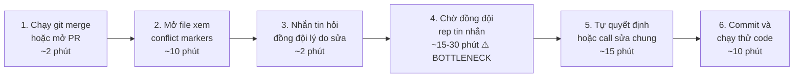
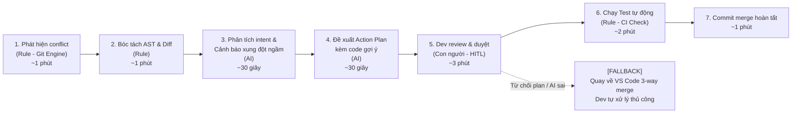

# Báo cáo nhóm — Day 02 Discovery & Problem Framing

> Bản chung của nhóm, viết trên repo do nhóm trưởng fork. Không copy file này sang repo cá nhân.
> Template chi tiết và prompt mẫu: [docs/01-worksheet.md](../../docs/01-worksheet.md). Bài mẫu: [docs/02-deliverable-example.md](../../docs/02-deliverable-example.md).

## 1. Thông tin nhóm

- Tên nhóm: B3
- Thành viên:
  1. Đỗ Lý Hoàng Nam (MSSV: 2A202603777)
  2. Lê Anh Tuấn (MSSV: 2A202603792)
  3. Nguyễn Đức Mạnh (MSSV: 2A202603731)
  *(Chi tiết phân công xem `TEAM.md`)*
- Candidate problem được chọn (1 câu): Giải thích ngữ cảnh nghiệp vụ và hỗ trợ xử lý xung đột mã nguồn (Git Merge Conflict & Semantic Code Review) nhằm ngăn ngừa lỗi logic ngầm làm sập hệ thống khi tích hợp dự án nhóm.
- Quyết định cuối: Go (ở phạm vi pilot nhỏ, kiểm chứng chi tiết tại CP6)

---

## 2. Hội tụ nhóm (CP3)

### 2.1. Pitch

| # | Người đưa ra | Candidate (Job Story ngắn) | Actor | Bottleneck | Câu hỏi phản biện nhận được (ai hỏi) |
|---:|---|---|---|---|---|
| 1 | Lê Anh Tuấn | Khi sắp tới deadline nộp bài lab, tôi muốn biết bài còn thiếu mục nào so với yêu cầu, để không bị trừ điểm vì sai cấu trúc | Học viên tự nộp bài lab qua repo GitHub | Đối chiếu từng mục với checklist và rubric, khoảng 10 phút/lần; đã bị trừ điểm 2–3 lần | "Đã có giải pháp nào tương tự chưa? Sản phẩm này có gì tốt hơn so với các sản phẩm đó?" (Đỗ Lý Hoàng Nam) |
| 2 | Lê Anh Tuấn | Khi tới cuối tháng, tôi muốn biết mình đã tiêu bao nhiêu vào từng nhóm việc từ nhiều app ngân hàng/ví, để điều chỉnh chi tiêu tháng sau | Người dùng 2–4 app ngân hàng/ví | Phân loại giao dịch (nhất là chuyển khoản ghi nội dung mơ hồ), khoảng 15 phút/tháng; dễ bỏ dở | |
| 3 | Lê Anh Tuấn | Khi cài hoặc chạy tool/thư viện cho bài lab mà gặp lỗi, tôi muốn biết nhanh nguyên nhân và cách sửa, để không mất cả buổi sửa môi trường | Học viên tự cài môi trường trên máy cá nhân | Tìm cách sửa trên mạng và thử từng cách, khoảng 25 phút/lần; 1–2 lần/tuần | |
| 4 | Đỗ Lý Hoàng Nam | Khi merge code bị conflict, tôi muốn hiểu vì sao đoạn code đó được viết và hệ quả của việc giữ/xóa, để resolve đúng mà không làm hỏng tính năng của người khác | Lập trình viên tích hợp code trong nhóm đồ án 3–4 người | Chờ đồng đội trả lời để hiểu ngữ cảnh, 15–30 phút/lần; 1–2 lần/tuần | "Làm thế nào AI có thể biết chính xác mục đích của một đoạn code nếu không có tài liệu hoặc commit message giải thích?" (Lê Anh Tuấn); "Tại sao nên sử dụng giải pháp AI của nhóm thay vì các công cụ sẵn có như GitHub Copilot hoặc Git Merge Tools?" (Nguyễn Đức Mạnh) |
| 5 | Đỗ Lý Hoàng Nam | Khi bắt đầu bài lab có quy chế chấm dài, tôi muốn nắm ngay tiêu chí chấm và các ranh giới bị trừ điểm, để không làm lệch yêu cầu | Sinh viên đọc đề và rà soát tiêu chí cho nhóm | Đọc 15–20 trang đề (~45 phút) và đối chiếu bài với rubric trước khi nộp (~30 phút); từng bị trừ 2 điểm vì sót mục | |
| 6 | Đỗ Lý Hoàng Nam | Khi đến hạn báo cáo tiến độ đồ án hằng tuần, tôi muốn tổng hợp nhanh việc đã xong kèm minh chứng, để nộp đúng hạn mà không mất cả buổi tối | Nhóm trưởng / người viết báo cáo tiến độ | Chụp, ghép ảnh minh chứng (~20 phút) và viết lại changelog thành văn báo cáo (~25 phút); 15 tuần/kỳ | |
| 7 | Nguyễn Đức Mạnh | Khi bắt đầu một đề tài AI, tôi muốn nhanh chóng nắm nội dung, phương pháp, đóng góp, hạn chế của các paper liên quan, để không mất thời gian vào nghiên cứu không phù hợp | AI Researcher | Đọc và sàng lọc nội dung paper; thời gian chưa đo | "Nếu so sánh với việc gửi link bài báo cho Claude/ChatGPT thì sao?" (Lê Anh Tuấn/Đỗ Lý Hoàng Nam) |
| 8 | Nguyễn Đức Mạnh | Khi muốn thay thế một module trong mô hình, tôi muốn tổng hợp và so sánh các phương pháp tương đồng, để chọn phương pháp phù hợp để thử nghiệm | AI Researcher / AI Engineer | Tìm, tổng hợp và so sánh phương pháp từ nhiều paper; thời gian chưa đo | |
| 9 | Nguyễn Đức Mạnh | Khi chạy nhiều experiment, tôi muốn lưu đầy đủ cấu hình và kết quả từng lần chạy, để truy xuất và so sánh được | AI Engineer / ML Researcher | Ghi nhận, truy xuất, đối chiếu cấu hình với kết quả; thời gian chưa đo | |

### 2.2. Cluster

| Cluster | Các candidate | Pattern chung |
|---|---|---|
| **A. Tích hợp mã nguồn & Quản lý phát triển phần mềm** | Candidate #4 (Git Conflict), #3 (Sửa lỗi môi trường lab), #6 (Báo cáo tiến độ tuần) | Nỗi đau kỹ thuật và vận hành khi phát triển code chung trong nhóm đồ án: thiếu ngữ cảnh khi đọc code người khác, xung đột mã nguồn và nguy cơ phá vỡ tính năng hệ thống. |
| **B. Hỗ trợ nghiên cứu & Thử nghiệm mô hình AI** | Candidate #7 (Sàng lọc paper), #8 (So sánh module mô hình), #9 (Lưu cấu hình experiment) | Khó khăn của người làm nghiên cứu AI khi đối mặt với lượng tài liệu học thuật khổng lồ, thiếu công cụ theo dõi và đối chiếu phương pháp/kết quả thực nghiệm tập trung. |
| **C. Hỗ trợ học tập, Quy chế bài lab & Đời sống cá nhân** | Candidate #1 (Đối chiếu checklist nộp bài lab), #5 (Nắm bắt tiêu chí đề lab dài), #2 (Phân loại chi tiêu nhiều ví) | Quá tải thông tin quy chế; áp lực rà soát thủ công dẫn đến rủi ro bị trừ điểm oan hoặc bỏ dở việc kiểm soát cá nhân. |

### 2.3. Opportunity Solution Tree rút gọn

Gốc là **1 outcome**. Nhánh là **opportunity** (nhu cầu, pain), không phải tính năng hay công cụ.

```text
OUTCOME: Giảm thiểu thời gian gián đoạn kỹ thuật và rủi ro lỗi hệ thống khi phối hợp phát triển đồ án nhóm
├── Opportunity A: Khó khăn trong việc hiểu ý đồ sửa code của đồng đội khi resolve conflict, dẫn đến lãng phí thời gian chờ đợi và gây xung đột logic làm hỏng nhánh main (Candidate #4)
├── Opportunity B: Mất nhiều thời gian tìm kiếm, đọc hiểu và so sánh các phương pháp/mô hình AI từ tài liệu nghiên cứu phân tán (Candidate #7, #8)
└── Opportunity C: Khó đối chiếu và kiểm soát toàn diện các tiêu chí đánh giá phức tạp của bài lab trước giờ deadline nộp bài (Candidate #1, #5)
```

Những ý đã gạch bỏ vì là solution đội lốt opportunity:

- *"Xây dựng extension tự động sửa conflict"* (Solution trá hình $\rightarrow$ Nhu cầu thực tế: Hiểu được lý do sửa code để resolve an toàn mà không làm hỏng tính năng).
- *"Dùng chatbot tóm tắt PDF bài báo nghiên cứu"* (Solution trá hình $\rightarrow$ Nhu cầu thực tế: Nắm nhanh phương pháp cốt lõi và hạn chế của các nghiên cứu liên quan).
- *"Viết script tự động phân loại chi tiêu ngân hàng"* (Solution trá hình $\rightarrow$ Nhu cầu thực tế: Theo dõi dòng tiền cá nhân minh bạch mà không tốn công phân loại tay).

### 2.4. Chấm điểm shortlist (1–5)

| Candidate | Actor rõ | Quy trình rõ | Pain có bằng chứng | Impact đo được | Vừa sức lab | So sánh được No AI/Rule/Workflow/Agent | Nhóm hiểu domain | Tổng |
|---|---:|---:|---:|---:|---:|---:|---:|---:|
| **1. Git Merge Conflict & Semantic Code Review (Cand. #4)** | 5 | 5 | 5 | 5 | 4 | 5 | 5 | **34** |
| **2. Sàng lọc & So sánh phương pháp nghiên cứu AI (Cand. #7, #8)** | 4 | 4 | 4 | 3 | 3 | 4 | 4 | **26** |
| **3. Đối chiếu Checklist & Quy chế bài lab (Cand. #1, #5)** | 5 | 4 | 5 | 4 | 4 | 4 | 4 | **30** |

**Candidate được chọn:** **Git Merge Conflict & Semantic Code Review (Candidate #4)**

**Vì sao chọn:**
1. Đạt điểm số đánh giá cao nhất (**34/35 điểm**); giải quyết trực tiếp nỗi đau cốt lõi của lập trình viên: **xung đột mã nguồn và nguy cơ phá hỏng nhánh main trước giờ demo sản phẩm**.
2. Quy trình hiện tại có nút thắt đo lường được bằng số liệu thực tế: **mất 15–30 phút/lần chờ đợi đồng đội trả lời tin nhắn để hiểu ngữ cảnh code**.
3. Khoảng trống thị trường vượt trội: Các công cụ hiện có (VS Code 3-way merge, GitLens) chỉ so sánh chữ thô (text diff), hoàn toàn không hiểu ngữ cảnh nghiệp vụ và không phát hiện được xung đột logic ngầm (Semantic Conflict).
4. Đủ điều kiện kỹ thuật để so sánh 4 mức can thiệp (No AI / Rule / Workflow / Agent) và có bộ metric định lượng rõ ràng (giảm thời gian từ 45' xuống ≤ 8', giảm lỗi regression bug từ 15% về < 1%).

**Vì sao loại các candidate còn lại:**
* **Loại Candidate #7, #8 (Sàng lọc paper AI):** Rủi ro bị thay thế lớn bởi các công cụ LLM phổ thông (Claude, ChatGPT, Consensus, Perplexity); thời gian và số liệu đo lường chưa cụ thể ("thời gian chưa đo"); phạm vi bài toán quá rộng, khó hoàn thành trọn vẹn trong khuôn khổ buổi lab.
* **Loại Candidate #1, #5 (Checklist nộp bài lab):** Dễ giải quyết bằng quy trình thủ công (in rubric, dùng bảng checklist chia nhau cross-check) hoặc copy vào ChatGPT tóm tắt; tần suất sử dụng không thường xuyên bằng việc commit code hàng ngày.
* **Loại Candidate #2 (Chi tiêu app ví) và #3 (Lỗi cài môi trường):** Bài toán chi tiêu bị cạnh tranh bởi các app quản lý tài chính chuyên dụng; bài toán lỗi môi trường phụ thuộc quá nhiều vào OS/phần cứng máy cá nhân, khó chuẩn hóa quy trình.

**Xử lý bất đồng (nếu có):**
Ban đầu nhóm có các câu hỏi chất vấn sâu về tính khả thi của bài Git Conflict:
- *Bạn Tuấn hỏi:* *"Làm thế nào AI biết chính xác mục đích của một đoạn code nếu không có commit message giải thích?"* $\rightarrow$ Bạn Nam giải thích: AI sẽ phân tích cây cú pháp AST, call graph và lịch sử các commit/PR liền kề trong nhánh để suy luận luồng logic, kết hợp cơ chế Human-in-the-loop (luôn hỏi lại dev xác nhận).
- *Bạn Mạnh hỏi:* *"Tại sao nên dùng giải pháp nhóm thay vì GitHub Copilot hay Git Merge Tools?"* $\rightarrow$ Bạn Nam phân tích: Git Merge Tools chỉ so sánh text thô, còn Copilot chỉ gợi ý code completion cục bộ; giải pháp của nhóm tập trung vào khoảng trống **Pre-merge Semantic Gatekeeper** (hiểu ý đồ nghiệp vụ và cảnh báo xung đột logic ngầm).
Sau khi trao đổi, cả 3 thành viên đã hoàn toàn đồng thuận chọn bài toán Git Merge Conflict.

---

## 3. Kiểm chứng + research giải pháp đã có (CP4)

### 3.1. Assumption Map

| # | Giả định | Loại (Value / Usability / Feasibility / Viability) | Quan trọng (1–5) | Đã có bằng chứng (1–5) | Kiểm chứng trước? |
|---:|---|---|---:|---:|---|
| 1 | Lập trình viên mất từ 20–45 phút mỗi lần giải quyết conflict và rất sợ bị ghi đè làm mất tính năng của đồng đội trước giờ demo. | Value | 5 | 3 | **Có (Kiểm chứng trước)** |
| 2 | Nút thắt lớn nhất khi conflict không phải là thao tác git, mà là thiếu thông tin ngữ cảnh để hiểu "tại sao đồng đội lại sửa đoạn code này". | Value | 5 | 2 | **Có (Kiểm chứng trước)** |
| 3 | Lập trình viên sẵn sàng đọc bản giải thích tóm tắt bằng tiếng người và làm theo Action Plan gợi ý thay vì tự đọc từng dòng diff thô. | Usability | 4 | 2 | **Có (Kiểm chứng trước)** |
| 4 | AI có thể phân tích được commit history, PR context và cấu trúc AST để phát hiện xung đột logic ngầm (Semantic Conflict) giữa các file. | Feasibility | 4 | 3 | Không (Thử nghiệm ở prototype) |
| 5 | Chi phí gọi API LLM cho mỗi lần phân tích conflict là rất nhỏ (< 0.03$/lần), phù hợp với ngân sách sinh viên và nhóm dự án nhỏ. | Viability | 3 | 4 | Không |

**Giả định nhóm kiểm chứng trong buổi này:**
- **Giả định #1 & #2:** Nỗi đau thực tế về thời gian chờ đợi, sự thiếu hụt ngữ cảnh khi merge và rủi ro sập hệ thống sát giờ nộp bài/demo.

### 3.2. Kiểm chứng

**Cách đã dùng:** Phỏng vấn sâu người thật (theo phương pháp *The Mom Test* — tập trung vào hành vi và sự cố thực tế đã xảy ra trong quá khứ, không hỏi câu hỏi giả định "Bạn có muốn...").

#### Interview Snapshot 1
| Trường | Nội dung |
|---|---|
| Người được hỏi | Bạn P. — Backend Developer, đồ án môn Công nghệ Phần mềm (nhóm 4 người) |
| Câu nói đáng nhớ nhất (nguyên văn) | *"Tuần trước tớ merge nhánh auth của tớ vào develop, tự nhiên tính năng giỏ hàng của bạn kia lăn ra chết vì tớ đổi cấu trúc token mà không nói trước."* |
| Lần gần nhất gặp vấn đề này: chuyện gì đã xảy ra? | Bạn P. đổi tên trường trong token JWT ở file `authService.js`. Git báo auto-merge thành công vì bạn kia sửa file `cartService.js`. Đến lúc chạy thử trước giờ nộp bài thì API bị crash 500 hàng loạt. |
| Hiện đang xử lý bằng cách nào (workaround)? | Cả nhóm phải bật call Discord lúc 1h đêm, dùng `git revert` và ngồi soi từng file commit cũ để chắp vá lại code. |
| Mất bao lâu, bao lần? | Mất hơn 2 tiếng đồng hồ để debug và merge lại; xảy ra 1–2 lần mỗi sprint nước rút. |
| Insight / opportunity rút ra | Nỗi sợ lớn nhất không phải là conflict cú pháp mà là **xung đột logic ngầm (Semantic Conflict)** giữa các file mà Git bỏ lọt. |

#### Interview Snapshot 2
| Trường | Nội dung |
|---|---|
| Người được hỏi | Bạn H. — Frontend Developer, đồ án tốt nghiệp Web (nhóm 3 người) |
| Câu nói đáng nhớ nhất (nguyên văn) | *"Mỗi lần merge bị conflict, tớ toàn phải chụp màn hình gửi vào nhóm chat hỏi 'Ai sửa chỗ này thế?', đợi mãi bạn ấy mới rep nên tớ hay bấm đại accept current cho xong."* |
| Lần gần nhất gặp vấn đề này: chuyện gì đã xảy ra? | Đụng chung file cấu hình router điều hướng. Bạn H. nhắn tin nhưng đồng đội đang đi học không trả lời. Sốt ruột nên bạn bấm chọn code của mình, vô tình xóa mất 2 route trang thanh toán của bạn kia. |
| Hiện đang xử lý bằng cách nào (workaround)? | Chụp ảnh màn hình gửi Zalo/Discord rồi ngồi chờ; nếu gấp thì tự ý merge rồi nhắn bạn kia "tớ lỡ xóa gì thì cậu code lại nhé". |
| Mất bao lâu, bao lần? | Mất trung bình 30 phút chờ đợi mỗi lần; tuần trước làm mất 2 trang giao diện khiến bạn kia mất thêm 45 phút viết lại. |
| Insight / opportunity rút ra | **Thời gian chờ đợi (Blocked time)** và sự mù mờ về ngữ cảnh là nguyên nhân trực tiếp dẫn đến việc dev tự ý merge bừa gây mất code. |

#### Interview Snapshot 3
| Trường | Nội dung |
|---|---|
| Người được hỏi | Bạn K. — Fullstack Developer, dự án nhóm 2 người môn Lập trình Web |
| Câu nói đáng nhớ nhất (nguyên văn) | *"Nhóm tớ có 2 người, chia task độc lập theo module nên ít khi conflict lắm, trừ khi đụng vào file cấu hình chung `package.json` thì sửa tay 5 phút là xong."* |
| Lần gần nhất gặp vấn đề này: chuyện gì đã xảy ra? | Cả 2 cùng cài thêm thư viện UI mới, bị conflict file `package.json`. Mở file xóa marker bằng tay rồi chạy `npm install` lại. |
| Hiện đang xử lý bằng cách nào (workaround)? | Nhắn tin báo trước: "Tớ sắp cài thư viện X nhé, cậu đừng đụng vào package.json". |
| Mất bao lâu, bao lần? | Tốn khoảng 5–10 phút; tần suất rất ít (khoảng 2 tuần một lần). |
| Insight / opportunity rút ra | **Tín hiệu phản bác:** Với nhóm nhỏ 2 người chia module hoàn toàn độc lập, conflict ít xảy ra và sửa tay được. Giải pháp có giá trị ROI cao nhất với nhóm từ 3–5 người trở lên hoặc dự án có cấu trúc code đan xen. |

#### Tổng hợp:

| Nguồn | Số người / số mẫu | Tín hiệu xác nhận | Tín hiệu phản bác |
|---|---:|---|---|
| Phỏng vấn sâu sinh viên CNTT làm đồ án nhóm | 3 sinh viên (nhóm từ 2 đến 4 người) | 2/3 người xác nhận mất từ 30 phút đến 2 tiếng mỗi lần dính conflict; từng làm sập hệ thống hoặc xóa nhầm code bạn vì không hiểu ngữ cảnh; nút thắt lớn nhất là chờ đợi đồng đội giải thích. | 1/3 người (nhóm 2 người, module độc lập) cho biết ít khi bị conflict và có thể tự sửa tay nhanh chóng nếu chỉ là file cấu hình đơn giản. |

**Nhóm đã sửa problem thế nào sau kiểm chứng:**
1. **Thu hẹp đối tượng trọng tâm:** Định vị sản phẩm phục vụ các **nhóm đồ án / đội ngũ phát triển từ 3 người trở lên**, đặc biệt là giai đoạn nước rút trước hạn release/demo.
2. **Mở rộng phạm vi kỹ thuật:** Nhóm nhận ra nỗi đau lớn nhất không chỉ là các dòng code bị conflict trực tiếp (`<<<<<<< HEAD`), mà là **xung đột logic ngầm (Semantic Conflict)** giữa các file. Do đó, nhóm quyết định bổ sung tính năng **Pre-merge Semantic Check** vào bài toán.

### 3.3. Research giải pháp đã có

| Công cụ / case / pattern | Link | Giải bước nào trong quy trình? | Điểm mạnh | Khoảng trống / rủi ro | Bài học cho nhóm |
|---|---|---|---|---|---|
| **SemanticMerge** (Codice / Unity) | https://www.semanticmerge.com/ | Giải bước phân tích cú pháp và tự động ghép code khi conflict. | Phân tích dựa trên Cây cú pháp (AST); ghép code thành công khi hàm bị di chuyển vị trí hoặc đổi format. | **Mù ngôn ngữ tự nhiên:** Không đọc commit/PR để hiểu ý đồ dev; không phát hiện được xung đột logic giữa các file khác nhau; hỗ trợ ít ngôn ngữ. | Cần kết hợp AST với LLM để đọc hiểu ý định nghiệp vụ (intent) bằng ngôn ngữ tự nhiên. |
| **CodeRabbit** (AI Code Review) | https://coderabbit.ai/ | Giải bước rà soát mã nguồn trên Pull Request. | Đọc PR bằng tiếng người rất tốt; tóm tắt thay đổi và phát hiện lỗi logic/bảo mật trước khi merge. | **Không xử lý merge conflict:** Chỉ review PR 1 chiều; khi có xung đột giữa 2 nhánh thì không hỗ trợ lập plan gỡ conflict. | Kế thừa cách tiếp cận tóm tắt PR bằng ngôn ngữ tự nhiên để giải thích nguyên nhân conflict cho dev. |
| **VS Code 3-way Merge Editor** | https://code.visualstudio.com/ | Cung cấp giao diện trực quan để dev chọn giữ/xóa code. | Giao diện 3 cột trực quan (Current - Incoming - Result); tích hợp sẵn trong IDE phổ biến nhất. | **Mù ngữ cảnh 100%:** Chỉ so sánh text diff thô; dev vẫn phải tự đọc hiểu bằng mắt và tự chịu rủi ro nếu chọn nhầm. | Không cố làm lại giao diện diff, mà làm **Trợ lý phân tích ngữ cảnh (Intelligence Layer)** cắm vào luồng làm việc sẵn có. |

---

## 4. Quy trình trước/sau (CP5)

### 4.1. Quy trình hiện tại

Sơ đồ quy trình hiện tại:



| Bước | Actor | Input | Output | Thời gian / tần suất | Ghi chú |
|---:|---|---|---|---|---|
| 1 | Lập trình viên | Lệnh `git merge` hoặc thao tác mở PR | Thông báo `CONFLICT (content)` | ~2 phút (1–2 lần/tuần) | Bắt đầu phát hiện xung đột |
| 2 | Lập trình viên | File chứa ký hiệu `<<<<<<<` | Nhận diện vị trí dòng bị va chạm | ~10 phút | Chỉ thấy dòng chữ khác nhau, chưa hiểu lý do |
| 3 | Lập trình viên | Nhóm chat Zalo/Discord | Tin nhắn hỏi: "Sao cậu sửa đoạn này thế?" | ~2 phút | Phải tìm đúng người đã commit |
| 4 | Lập trình viên + Bạn cùng nhóm | Tin nhắn hỏi | Tin nhắn giải thích lý do sửa code | **15–30 phút ⚠️ BOTTLENECK** | Phụ thuộc vào việc đồng đội có online hay không |
| 5 | Lập trình viên | Hai đoạn code + Lời giải thích | Quyết định chọn giữ/xóa/kết hợp | ~15 phút | Nguy cơ xóa nhầm code nếu giải thích không rõ |
| 6 | Lập trình viên | Đoạn code đã merge | Commit resolve conflict | ~10 phút | Dễ phát sinh regression bug sau đó |

**Bottleneck chính:** **Bước 4 (Chờ đồng đội phản hồi để hiểu ngữ cảnh nghiệp vụ, mất 15–30 phút)**. Đây là nguyên nhân khiến cả luồng làm việc bị tắc nghẽn (blocked) và thôi thúc dev tự ý bấm chọn bừa gây sập hệ thống.

### 4.2. Quy trình tương lai

Ghi rõ bước nào **Rule**, bước nào **AI**, bước nào **con người**, **boundary** ở đâu, **phương án quay về** khi AI sai.



* **Phân định rõ vai trò:**
  * **Rule:** Bước 1 (Git engine phát hiện conflict file), Bước 2 (Parse cấu trúc cây cú pháp AST, trích xuất commit log), Bước 6 (Chạy linter và test suite tự động kiểm tra cú pháp).
  * **AI (Workflow):** Bước 3 (Đọc PR context + commit messages để giải thích ý định nghiệp vụ và cảnh báo lỗi logic ngầm), Bước 4 (Sinh Action Plan 3 bước hướng dẫn resolve an toàn).
  * **Con người (Human-in-the-loop - HITL):** Bước 5 (Lập trình viên xem xét giải thích của AI, đối chiếu code gợi ý, có quyền chỉnh sửa hoặc bấm duyệt cuối cùng).
* **Boundary (Ranh giới cấm của AI):**
  * AI tuyệt đối **KHÔNG ĐƯỢC tự động commit** hoặc tự ý đẩy (push) code vào nhánh chính.
  * AI không được tự động xóa các đoạn mã liên quan đến bảo mật (authentication, token), thanh toán hoặc cơ sở dữ liệu nếu không có sự xác nhận của lập trình viên.
* **Phương án quay về (Fallback) khi AI sai:**
  * Nếu AI không thể suy luận được ngữ cảnh (độ tin cậy < 80%) hoặc gợi ý bị dev từ chối, hệ thống lập tức kích hoạt cơ chế Fallback: tự động mở giao diện **VS Code 3-way merge truyền thống** để lập trình viên tự xử lý thủ công, đồng thời cảnh báo dev liên hệ trực tiếp với tác giả đoạn code.

### 4.3. Before / after

| Chỉ số | Trước | Sau (kỳ vọng) | Ghi chú |
|---|---:|---:|---|
| **Số bước quy trình** | 6 bước | 5 bước chính (+ 1 bước test) | Quy trình liền mạch ngay trong IDE |
| **Tổng thời gian** | 35–45 phút/lần | **≤ 8 phút/lần** | Tiết kiệm hơn 80% thời gian |
| **Số bước thủ công** | 5 bước (mở file, nhắn tin, chờ đợi, tự sửa, commit) | **1 bước duy nhất** (Dev review và bấm xác nhận) | Tối ưu hóa tối đa sức người |
| **Bottleneck chính** | Chờ đồng đội rep tin nhắn (15–30 phút) | **Được giải phóng hoàn toàn:** AI phân tích và lập plan trong 30 giây | Xóa bỏ blocked time |
| **Rủi ro mới phát sinh** | Xóa nhầm code do phỏng đoán mù mờ | AI có thể ảo giác sinh code gợi ý sai cú pháp | **Kiểm soát triệt để:** Bắt buộc con người kiểm duyệt (HITL) + Chạy test suite tự động trước khi commit |

---

## 5. Problem Statement v0 (CP5)

| Trường | Nội dung |
|---|---|
| **Actor** | Lập trình viên trong nhóm đồ án môn học (3–4 người) phụ trách tích hợp mã nguồn vào nhánh chính cuối sprint hoặc khi tạo Pull Request |
| **Quy trình** | Khi phát hiện xung đột mã nguồn $\rightarrow$ Mở file đọc ký hiệu conflict $\rightarrow$ Nhắn tin hỏi đồng đội lý do sửa code $\rightarrow$ Chờ phản hồi $\rightarrow$ Thống nhất giải pháp $\rightarrow$ Sửa code thủ công và commit merge |
| **Bottleneck** | Bước chờ đợi đồng đội phản hồi để hiểu ngữ cảnh nghiệp vụ của đoạn code xung đột (mất 15–30 phút), dễ dẫn đến việc dev tự ý merge bừa gây mất code |
| **Impact** | Tốn 30–60 phút mỗi ca conflict; nguy cơ ghi đè làm mất tính năng của nhau và gây lỗi sập server trước giờ demo (Regression bug xảy ra ở ~15% số lần merge); làm trễ hạn nộp bài |
| **Success Metric** (baseline → target, cách đo) | - Thời gian giải quyết conflict: Baseline 35–45 phút $\rightarrow$ Target: ≤ 8 phút/lần.<br>- Tỷ lệ lỗi logic sau merge: Baseline 15% $\rightarrow$ Target: < 1%.<br>- Blocked time (thời gian chờ đợi): Baseline 15–30 phút $\rightarrow$ Target: 0 phút.<br>*Cách đo:* Ghi log thời gian giải quyết và đếm số bug phát sinh sau merge qua 3 sprint liên tiếp. |
| **Boundary** (AI không được làm gì; khi nào cần con người kiểm tra — HITL) | AI không được tự động commit code lên repo; không được tự ý xóa bỏ các đoạn code nghiệp vụ quan trọng. Bắt buộc lập trình viên phải trực tiếp xem xét và bấm phê duyệt phương án giải quyết (Human-in-the-loop). |

**Phản biện nhận được (từ AI hoặc nhóm khác) và nhóm có đồng ý không:**
- *Phản biện nhận được:* "Nếu hai nhánh sửa đổi logic ở hai file hoàn toàn khác nhau thì quy trình này có phát hiện được không?"
- *Nhóm đồng ý:* Nhóm hoàn toàn đồng ý và ghi nhận đây là điểm yếu chí mạng của các công cụ Git hiện tại. Nhóm quyết định bổ sung tính năng **Pre-merge Semantic Check** vào Problem Statement v1 (ở CP6) để mở rộng khả năng cảnh báo sớm các lỗi logic ngầm trước khi bấm merge.

---

## 6. Mức can thiệp AI (CP6)

### 6.1. Ma trận độ mơ hồ × độ phức tạp

Bài của nhóm nằm ở ô: **Độ mơ hồ Thấp — Độ phức tạp Cao**

Vì sao:
- *Độ mơ hồ thấp:* Mục tiêu đầu ra rất rõ ràng và xác định — code sau khi merge phải biên dịch được, không bị gãy tính năng cũ (no regression bugs), và giữ được đúng ý đồ nghiệp vụ của cả hai nhánh.
- *Độ phức tạp cao:* Đòi hỏi phải phân tích ngữ cảnh lớn từ nhiều file mã nguồn, cấu trúc cây cú pháp (AST), lịch sử commit, mô tả Pull Request và các mối quan hệ phụ thuộc chéo giữa các module.

### 6.2. So sánh 4 mức

| Mức | Phương án cho bài của nhóm | Đủ khi nào | Rủi ro | Chọn? |
|---|---|---|---|:---:|
| **No AI** (sửa quy trình) | Bắt buộc họp call Discord chia sẻ màn hình cùng merge code; áp dụng quy ước viết commit message chi tiết. | Đủ khi dự án nhỏ (2 người), code đơn giản, cả 2 cùng rảnh rỗi online cùng lúc. | Tốn thời gian của cả 2 người (15–30 phút/lần); gây tắc nghẽn (block) tiến độ release nếu một người bận hoặc lệch múi giờ. | ❌ Không |
| **Rule** | Dùng Linter, Prettier kiểm tra cú pháp + công cụ merge theo cây cú pháp AST (như SemanticMerge). | Đủ khi xung đột chỉ là di chuyển vị trí hàm hoặc định dạng lại thụt dòng. | Hoàn toàn "mù" về mặt ý đồ nghiệp vụ (intent); không phát hiện được xung đột logic giữa các file khác nhau; không đọc được commit message. | ❌ Không |
| **Workflow** | AI đọc Git diff + Commit/PR context $\rightarrow$ Tóm tắt ý đồ bằng tiếng người $\rightarrow$ Phát hiện xung đột logic ngầm $\rightarrow$ Đề xuất Action Plan 3 bước $\rightarrow$ **Dev kiểm tra và bấm duyệt (Human-in-the-loop)**. | Đủ và tối ưu cho hầu hết mọi dự án nhóm: giải quyết triệt để nút thắt chờ đợi và ngăn chặn lỗi logic ngầm. | AI có thể đưa ra gợi ý chưa tối ưu $\rightarrow$ Kiểm soát bằng việc bắt buộc con người duyệt và chạy test tự động trước khi commit. | ✅ **CHỌN** |
| **Agent** | AI tự động quyết định chọn code nhánh nào, tự sửa code, tự chạy git commit và push thẳng vào nhánh `main` mà không cần con người xem xét. | Không bao giờ nên dùng cho việc merge code sản phẩm. | Rủi ro cực kỳ nguy hiểm (Critical): AI có thể tự ý xóa nhầm code cốt lõi, gây sập server production mà không ai hay biết. | ❌ Không |

**Mức chọn:** **Workflow** (Human-in-the-loop)

**Vì sao không chọn mức đơn giản hơn:**
- *Mức Rule:* Chỉ giải quyết được mặt cú pháp thô, hoàn toàn bất lực trước **xung đột ngữ nghĩa (Semantic Conflict)** khi 2 dev đổi logic chéo nhau. Rule không có khả năng đọc hiểu ngôn ngữ tự nhiên trong commit/PR để trả lời câu hỏi *"Tại sao dev lại sửa dòng này"*.
- *Mức No AI:* Bắt buộc con người phải chờ đợi nhau (Blocked time 15–30 phút), làm chậm toàn bộ quy trình tích hợp liên tục (CI/CD).

### 6.3. AI Canvas rút gọn

| Thành phần | Nội dung |
|---|---|
| **Prediction** — AI dự đoán / tạo ra gì? | 1. Dự đoán ý định nghiệp vụ (intent) của từng nhánh dựa trên commit message và diff.<br>2. Phát hiện các điểm xung đột logic ngầm (Breaking changes / API mismatch).<br>3. Dự đoán và sinh ra Action Plan giải quyết xung đột gồm 3 bước kèm code gợi ý. |
| **Judgment** — con người cân nhắc, quyết định gì? | Lập trình viên (người merge) đánh giá xem giải thích của AI có đúng thực tế không, chọn phương án kết hợp tối ưu và duyệt code cuối cùng. |
| **Action** — hành động cuối cùng là gì, ai làm? | Lập trình viên bấm xác nhận giải pháp trên giao diện $\rightarrow$ Hệ thống tự động áp dụng code $\rightarrow$ Chạy test kiểm tra $\rightarrow$ Dev bấm commit merge. |
| **Outcome** — đo kết quả bằng gì? | - Thời gian xử lý conflict (từ 35–45 phút xuống ≤ 8 phút).<br>- Tỷ lệ lỗi logic sau merge (từ 15% xuống < 1%).<br>- Thời gian chờ đợi đồng đội (giảm từ 30 phút về 0 phút). |
| **Input** — AI cần dữ liệu đầu vào gì mỗi lần chạy? Có sẵn không? | Git diff của 2 nhánh, commit history, PR title/description, danh sách các hàm/biến bị thay đổi. **Dữ liệu này luôn có sẵn 100% trong Git repository.** |
| **Feedback** — lấy phản hồi ở đâu để cải thiện? | - Tỷ lệ dev chấp nhận Action Plan của AI (Acceptance Rate).<br>- Số lần dev phải chỉnh sửa lại code do AI gợi ý.<br>- Kết quả pass/fail của bộ test tự động sau khi merge. |

### 6.4. Hai câu hỏi của Google PAIR

- Người dùng muốn **được hỗ trợ (augment)** hay **giao hẳn việc (automate)**? Bằng chứng:
  * Người dùng muốn **Được hỗ trợ (Augment)**.
  * *Bằng chứng:* Mã nguồn là tài sản cốt lõi của dự án phần mềm. Các lập trình viên và Tech Lead không bao giờ chấp nhận để AI tự động ghi đè code lên nhánh `main` mà không có sự kiểm soát của con người. Người dùng chỉ cần AI giải thích ngữ cảnh và dọn sẵn phương án an toàn để họ ra quyết định nhanh hơn.
- AI sai kiểu nào tệ hơn, **báo nhầm** hay **bỏ sót**? Vì sao, và thiết kế đã xử lý thế nào:
  * **Bỏ sót (False Negative) tệ hơn rất nhiều**.
  * *Vì sao:* Nếu AI *báo nhầm* (False Positive - cảnh báo có xung đột logic nhưng thực tế không ảnh hưởng), dev chỉ mất 5 giây liếc mắt qua kiểm tra rồi bỏ qua, hệ thống vẫn an toàn. Nhưng nếu AI *bỏ sót* (False Negative - có xung đột ngầm gây crash mà AI không báo), code lỗi sẽ lọt vào nhánh `main` làm sập toàn bộ hệ thống ngay trước giờ demo sản phẩm.
  * *Thiết kế xử lý:* Hệ thống thiết lập độ nhạy cao (High Recall) đối với các thay đổi liên quan đến hàm cốt lõi, API public và biến môi trường; đồng thời bắt buộc luôn có bước chạy test cú pháp tự động trước khi cho phép merge.

---

## 7. Problem Statement v1 + tiêu chí đánh giá (CP6)

| Trường | Nội dung |
|---|---|
| **Actor** | Lập trình viên trong nhóm đồ án (3–4 người) phụ trách tích hợp code vào nhánh chính cuối sprint hoặc khi tạo Pull Request |
| **Quy trình** | Khi phát hiện xung đột code $\rightarrow$ Kích hoạt trợ lý AI đọc diff và commit context $\rightarrow$ AI cảnh báo xung đột logic ngầm và đưa ra Action Plan $\rightarrow$ Dev xem xét, chỉnh sửa và bấm duyệt $\rightarrow$ Chạy test kiểm tra tự động $\rightarrow$ Commit merge |
| **Bottleneck** | Bước phân tích để hiểu ý đồ sửa code của đồng đội và tìm giải pháp ghép code an toàn mà không làm gãy tính năng cũ |
| **Impact** | Tốn 30–60 phút mỗi ca conflict; nguy cơ ghi đè mất code và gây lỗi sập server trước giờ demo (Regression bugs chiếm ~15% số lần merge); làm gián đoạn tiến độ chung |
| **Success Metric** (baseline → target, cách đo) | - Thời gian resolve conflict: Baseline 35–45 phút $\rightarrow$ Target: ≤ 8 phút/lần.<br>- Tỷ lệ lỗi logic sau merge: Baseline 15% $\rightarrow$ Target: < 1%.<br>- Blocked time: Baseline 15–30 phút $\rightarrow$ Target: 0 phút.<br>*Cách đo:* Ghi log thời gian giải quyết và đếm số bug phát sinh sau merge qua 3 sprint liên tiếp. |
| **Boundary** | **AI KHÔNG ĐƯỢC:** Tự ý commit code vào nhánh chính; tự ý xóa các khối code chứa logic xác thực hoặc dữ liệu nếu không có sự đồng ý của dev.<br>**HITL:** Con người bắt buộc phải bấm nút phê duyệt phương án merge. |
| **AI intervention point** | Điểm can thiệp nằm ở bước: **Phân tích ngữ cảnh 2 nhánh (Commit + PR) $\rightarrow$ Cảnh báo xung đột ngầm $\rightarrow$ Sinh bản nháp Action Plan giải quyết xung đột**. |
| **Mức chọn** | **Workflow** (AI hỗ trợ phân tích và đề xuất plan, con người quyết định và thực thi) |
| **Rủi ro & người kiểm tra** | Rủi ro: AI sinh code gợi ý bị lỗi syntax hoặc ảo giác logic.<br>Người kiểm tra: Lập trình viên trực tiếp merge code + Bộ kiểm tra build/test tự động. |

**Thay đổi so với v0 và lý do:**

| Trường | v0 (ở CP5) | v1 (ở CP6) | Vì sao đổi |
|---|---|---|---|
| **AI intervention point** | Chưa xác định cụ thể | Nằm chính xác ở bước bóc tách commit context và lập Action Plan | Sau khi phân tích AI Canvas, nhóm nhận thấy đây là mắt xích AI tạo ra giá trị cao nhất giúp giải phóng thời gian chờ đợi. |
| **Mức chọn** | Dự kiến Workflow | Khẳng định dứt khoát mức **Workflow** (loại bỏ hoàn toàn Agent) | Phân tích Google PAIR chỉ ra dev chỉ muốn Augment (hỗ trợ), tuyệt đối không giao quyền Automate hoàn toàn cho AI vì rủi ro mất code. |
| **Rủi ro & kiểm soát** | Chưa có cơ chế fallback rõ ràng | Bổ sung quy định: Bắt buộc dev duyệt + Chạy test tự động trước khi commit | Nhận diện rõ rủi ro "bỏ sót lỗi" nguy hiểm hơn "báo nhầm", cần thêm chốt chặn an toàn bằng test tự động. |

**Tiêu chí đánh giá đầu ra của AI (3–5 tiêu chí):**

| # | Tiêu chí | Đạt khi | Không đạt khi |
|---:|---|---|---|
| 1 | **Tính chính xác ngữ cảnh (Contextual Accuracy)** | Tóm tắt đúng ý đồ nghiệp vụ của cả 2 nhánh dựa trên commit message và PR description; giải thích rõ vì sao có sự khác biệt. | Diễn giải sai lệch mục đích sửa code; ảo giác ra những tính năng không có trong commit. |
| 2 | **Độ bao phủ xung đột ngầm (Semantic Conflict Recall)** | Phát hiện được 100% các trường hợp đổi tên hàm, xóa hàm hoặc đổi kiểu dữ liệu giữa các file làm gãy nhánh kia. | Bỏ sót các breaking changes khiến code sau khi merge bị crash runtime. |
| 3 | **Tính khả thi của Action Plan (Actionability)** | Kế hoạch merge gồm các bước rõ ràng; đoạn code đề xuất biên dịch được, không dính lỗi cú pháp cơ bản. | Code gợi ý bị lỗi syntax, thiếu biến, hoặc đưa ra các bước hướng dẫn chung chung không thực thi được. |
| 4 | **Thời gian phản hồi (Latency)** | Hoàn thành việc phân tích và sinh Action Plan trong vòng **dưới 30 giây**. | Thời gian phản hồi quá 60 giây khiến dev cảm thấy sốt ruột và tự sửa tay. |

---

## 8. Quyết định (CP6)

### 8.1. Bốn rủi ro

| Rủi ro | Câu hỏi | Mức độ rủi ro (Thấp = an toàn / TB / Cao = nguy hiểm) | Lý do / bằng chứng |
|---|---|---|---|
| **Value** | Người dùng có thật sự cần và sẽ dùng không? | **Thấp (An toàn)** | Nhu cầu cực kỳ cấp thiết: Mọi lập trình viên đều sợ bị sập server trước ngày demo; việc tiết kiệm 30 phút mỗi lần conflict đem lại giá trị ROI tức thì. |
| **Usability** | Người dùng có dùng được, có hiểu và sửa được đầu ra của AI không? | **Thấp (An toàn)** | Tích hợp trực tiếp vào giao diện Git/PR quen thuộc; Action Plan viết bằng tiếng Việt/tiếng Anh tự nhiên rất dễ hiểu, dev chỉ cần chọn chấp nhận hoặc chỉnh sửa nhẹ. |
| **Feasibility** | Có đủ dữ liệu, công cụ, kỹ năng để làm không? | **Trung bình** | Dữ liệu Git diff và commit luôn có sẵn. Thách thức kỹ thuật nằm ở việc parse AST kết hợp với LLM prompt để đạt độ chính xác cao, nhưng hoàn toàn khả thi với các mô hình hiện nay. |
| **Viability** | Có hợp chi phí, pháp lý, quy định tổ chức không? Ai vận hành? | **Thấp (An toàn)** | Chi phí API cho mỗi ca conflict rất rẻ (khoảng 0.01$ - 0.03$/lần resolve). Không vi phạm bảo mật nếu dùng các mô hình cho phép bảo mật mã nguồn nội bộ. |

### 8.2. Kết luận

**Quyết định:** **Go (Triển khai — Phạm vi Pilot nhỏ)**

**Lý do:** Vấn đề có thật, giá trị Value rất cao, rủi ro Usability và Viability thấp. Mô hình can thiệp mức **Workflow** có con người kiểm tra (HITL) giúp triệt tiêu hoàn toàn rủi ro AI tự ý phá hỏng mã nguồn.

**Nếu Go — pilot nhỏ nhất:** Xây dựng một tiện ích mở rộng (VS Code Extension hoặc GitHub Action bot) thử nghiệm trên chính các đồ án nhóm của lớp học kỳ này, hỗ trợ ngôn ngữ JavaScript/TypeScript.

**Nếu Not Yet — cần kiểm chứng gì trước:** (Không áp dụng vì nhóm chọn Go).

**Nếu No-Go — nên làm gì thay AI:** (Không áp dụng vì nhóm chọn Go).

**Ngưỡng dừng** (nếu sau … mà … thì quay về …):
> *"Nếu sau **4 tuần thử nghiệm pilot** mà tỷ lệ chấp nhận Action Plan của dev **dưới 50%**, hoặc công cụ **gây phát sinh thêm lỗi build/crash quá 5%** số lần merge, nhóm sẽ dừng giải pháp AI này và quay về quy trình No AI (bắt buộc họp call Discord cùng xem màn hình khi merge)."*

---

## 9. Hạn chế và hướng tiếp theo

- **Hạn chế hiện tại:** 
  - Trong giai đoạn pilot, hệ thống mới chỉ tập trung phân tích mã nguồn cho hệ sinh thái JavaScript/TypeScript (Node.js, React) — là công nghệ phổ biến nhất của các đồ án sinh viên; chưa hỗ trợ các ngôn ngữ biên dịch tĩnh phức tạp như C/C++.
  - Chưa xử lý được các xung đột tệp tin nhị phân (ảnh, file 3D, database schema dạng binary) mà chỉ tập trung vào mã nguồn văn bản.
- **Hướng phát triển tiếp theo:**
  - Mở rộng hỗ trợ đa ngôn ngữ (Python, Java, Go).
  - Đóng gói thành một GitHub Action Bot chạy tự động trên mỗi Pull Request, giúp quét và bình luận cảnh báo xung đột ngữ nghĩa trực tiếp vào luồng review của nhóm.

## 10. Tài liệu tham khảo

1. **SemanticMerge** (Codice Software / Unity) — Công cụ phân tích cú pháp AST khi merge mã nguồn: https://www.semanticmerge.com/
2. **CodeRabbit** — Nền tảng AI Code Review tự động trên Pull Request: https://coderabbit.ai/
3. **Google PAIR (People + AI Research)** — Bộ nguyên tắc thiết kế trải nghiệm người dùng với AI (Augment vs Automate, Error Handling): https://pair.withgoogle.com/guidebook/
4. **Marty Cagan (Silicon Valley Product Group - SVPG)** — Khung đánh giá 4 rủi ro sản phẩm (Value, Usability, Feasibility, Viability): *Inspired: How to Create Tech Products Customers Love*.
5. **The Mom Test** (Rob Fitzpatrick) — Phương pháp phỏng vấn kiểm chứng nhu cầu khách hàng qua hành vi quá khứ.
